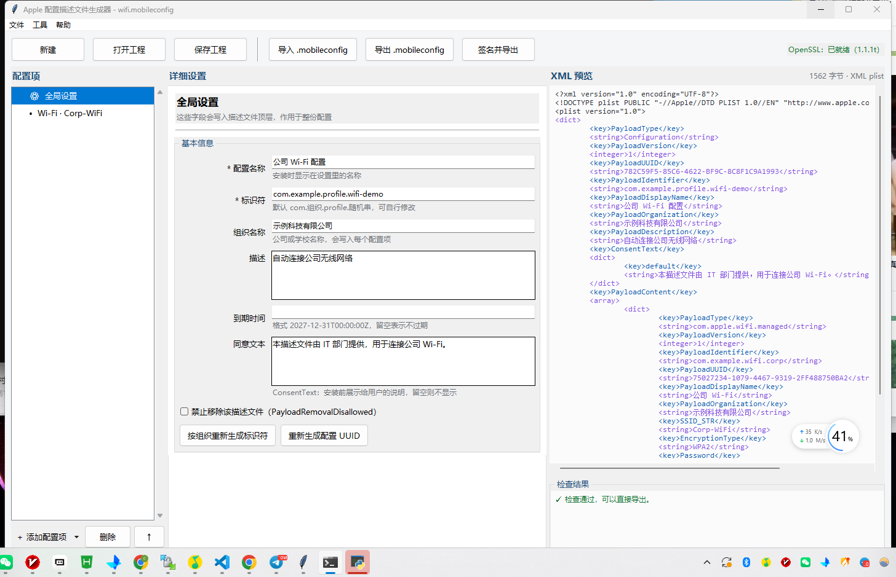

# Apple 配置描述文件生成器（Windows）

在 Windows 上创建、编辑、导出、签名 Apple 配置描述文件（`.mobileconfig`）。
定位是把 Apple Configurator 里“编辑 / 导出配置描述文件”的那部分搬到 Windows：
中文界面、点选配置、实时预览 XML、导出、可选签名，并且支持导入已有描述文件继续改。

- 版本：**1.0.0**（见 `VERSION`，代码中对应 `src/app/__init__.py` 的 `__version__`）
- 运行平台：Windows 10 / 11
- 技术栈：Python 3 + Tkinter（标准库 `plistlib` 生成 plist）+ 本机 OpenSSL（签名）



## 功能

- **5 类 payload**
  - Wi-Fi：SSID、WPA2 / WPA3、企业级 802.1X（PEAP / EAP-TLS / TTLS）、密码、隐藏网络、代理
  - 根证书：导入 `.cer/.crt/.der/.pem`，以原始 DER 字节写入 `PayloadContent`
  - PKCS#12：导入 `.p12/.pfx` + 密码，供 Wi-Fi / VPN 认证（输出 `com.apple.security.pkcs12`）
  - Web Clip：名称、URL、图标、是否全屏、是否可移除
  - 访问限制：相机、FaceTime、Safari、App 安装 / 删除、截图、账户修改等常用开关，以及强制密码策略
- **全局字段**：`PayloadDisplayName`、`PayloadIdentifier`（默认 `com.<组织>.<类型>.<uuid>`，可改）、
  `PayloadOrganization`、`PayloadDescription`、`PayloadRemovalDisallowed`、`PayloadExpirationDate`、`ConsentText`
- 每个 payload 自动生成唯一 UUID；右侧 XML 实时预览；导出前校验必填项、UUID 唯一、`PayloadType` 合法
- 导出 UTF-8 的 `.mobileconfig`
- **可选签名**：调用本机 OpenSSL `smime -sign`（SHA-256 / DER），支持 PEM 证书 + 私钥或 `.p12`，
  找不到 OpenSSL 时给出明确提示，仍可导出未签名版本
- **导入**已有 `.mobileconfig`（支持已签名的文件，会自动从 CMS 中取出 plist）；未知 `PayloadType` 原样保留，导出不丢
- **工程文件**：保存 / 打开 `.json`，证书与图标等二进制内容一并保存，方便反复修改
- **拖拽打开**：把 `.mobileconfig` 或 `.json` 工程拖到窗口任意位置即可加载；其它类型给出提示
- **证书信息（备案用）**：选择 Android `.keystore/.jks` 或 Apple `.p12/.pfx/.cer` 证书，读取
  MD5 / SHA-1 / SHA-256 指纹、公钥（Base64）、主题、颁发者、有效期等，APP 备案可直接复制填写
- 兼容 Windows 导出的旧式（RC2-40）加密 p12：签名前会自动转换，无需手动重新导出证书

## 快速开始

### 方式一：直接使用 exe

1. 在仓库的 **Releases** 页面下载 `Apple描述文件生成器.exe`（单文件，无需安装）。
2. 双击运行。签名功能需要本机有 OpenSSL（见下文“签名”）。

### 方式二：从源码运行

```powershell
git clone <本仓库地址>
cd <仓库目录>
python -m pip install -r requirements.txt   # 仅拖拽需要；不装也能运行，只是拖拽不可用
python src\main.py
```

`src/main.py` 也支持直接带一个文件路径启动：`python src\main.py examples\wifi.mobileconfig`。

## 打包单文件 exe

```powershell
python -m pip install -r requirements-dev.txt
python build.py
```

产物：`dist\Apple描述文件生成器.exe`（约 11 MB）。
`build.py` 已包含 `--onefile --windowed --collect-all tkinterdnd2`，会把 tkdnd 的 DLL 与 tcl 脚本一并打进 exe，
打包后的程序拖拽可用。

## iOS 安装要点

1. **必须用 Safari 下载**：用 iOS 自带 Safari 打开下载链接，其它浏览器可能无法触发“描述文件已下载”的提示。
2. **HTTP 头**：部署到 Web 服务器时返回 `Content-Type: application/x-apple-aspen-config`，
   文件扩展名保持 `.mobileconfig`，否则 iOS 可能把它当普通文件。
3. 下载后到 **设置 → 通用 → VPN 与设备管理**（旧系统为“描述文件”）安装；
   安装前会展示 `ConsentText`（同意文本），`PayloadRemovalDisallowed` 为真时用户不能自行删除。
4. 涉及根证书 / 企业 Wi-Fi 时，安装证书后还需在 **设置 → 通用 → 关于本机 → 证书信任设置** 中信任该根证书。
5. 把文件用微信 / 邮件传到手机通常不可靠；推荐 Safari 直接下载，或用 Apple Configurator / MDM 下发。
6. 本地测试可把文件放到任意 HTTP 服务（例如 `python -m http.server`）再用 Safari 访问；
   `file://` 与局域网 HTTP 均可，但正式分发建议 HTTPS。

## 签名

程序按以下顺序自动查找 OpenSSL：

1. 设置里手动指定的路径（`%APPDATA%\AppleMobileconfigGen\settings.json`）
2. `PATH` 中的 `openssl`
3. 程序目录 / 打包临时目录下的 `tools\openssl\`、`openssl\`、`tools\`
4. Git for Windows 自带的 `usr\bin\openssl.exe`、`mingw64\bin\openssl.exe`
5. `Program Files` 下的 OpenSSL-Win64 / Win32、Git、Shining Light OpenSSL

也可以把 `openssl.exe` 放到 exe 同级的 `tools\openssl\` 目录里，实现绿色便携。
签名命令等价于：

```text
openssl smime -sign -in profile.mobileconfig -signer cert.pem -inkey key.pem ^
        -outform DER -nodetach -md sha256 -out profile-signed.mobileconfig
```

## 已知限制

- 只覆盖上面 5 类 payload；其它类型导入后只能“原样保留”，不能在界面里编辑。
- 导入已签名文件不会保留原签名，需要重新签名。
- 签名依赖本机 OpenSSL；没有 OpenSSL 只能导出未签名版本。
- 拖拽走 Windows OLE：程序以管理员身份运行时，普通权限的资源管理器无法把文件拖进来（UIPI 限制），
  此时请使用“导入”按钮。
- 生成的 plist 是标准配置描述文件，但企业分发到大量设备仍建议配合 MDM。

## 目录结构

```text
.
├─ src/
│  ├─ main.py                # 入口：DPI 感知 + 启动窗口
│  └─ app/
│     ├─ __init__.py         # 版本号 __version__
│     ├─ profile.py          # 数据模型：payload 定义、构建/解析/校验/序列化
│     ├─ signing.py          # OpenSSL 查找、签名、从签名文件提取 plist
│     └─ ui.py               # 中文界面：三栏布局、表单、XML 预览、拖拽
├─ tests/
│  ├─ selfcheck.py           # 无界面自检（构建/校验/往返/签名/示例）
│  └─ ui_check.py            # 界面检查（文件选择、图标导出、拖拽处理）
├─ examples/                 # 三个可直接导入的示例
│  ├─ wifi.mobileconfig
│  ├─ webclip.mobileconfig
│  └─ restrictions.mobileconfig
├─ docs/
│  └─ screenshot-main.png    # 界面截图
├─ .github/workflows/ci.yml  # GitHub Actions：windows-latest 跑自检
├─ build.py                  # 一键打包单文件 exe
├─ requirements.txt          # 运行依赖（tkinterdnd2）
├─ requirements-dev.txt      # 打包依赖（PyInstaller）
├─ VERSION                   # 当前版本号
├─ CHANGELOG.md
├─ LICENSE                   # MIT
└─ README.md
```

## 开发与测试

```powershell
python tests\selfcheck.py   # 自检，全部通过会输出“全部通过（N 项检查）”
python tests\ui_check.py   # 会短暂创建窗口，检查文件选择/图标写回/拖拽逻辑
```

`selfcheck.py` 覆盖：XML 结构（`PayloadVersion` 为整数 1、`PayloadContent` 为数组、`PayloadType` 正确）、
导出→导入→再导出一致、未知 payload 保留、EAP 证书引用、工程 JSON 往返、校验规则、
OpenSSL 签名（DER 自检、`.p12` 签名、签名文件回读），并重写 `examples/` 下的示例。
`ui_check.py` 需要能创建窗口的桌面环境，CI 中未执行。

GitHub Actions：`windows-latest` 上安装依赖并跑 `tests/selfcheck.py`。
自动打包并发布到 Release 暂未开启——如需，可在 workflow 里加 `python build.py` 并用
`softprops/action-gh-release` 上传 `dist/*.exe`（需要 `permissions: contents: write`）。

## 授权

本项目使用 MIT 许可证，全文见 [`LICENSE`](LICENSE)。如需更换授权，请直接替换该文件并同步修改本节。
